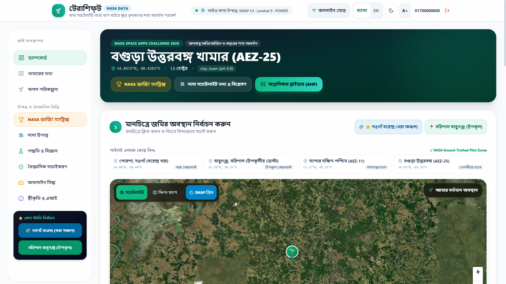
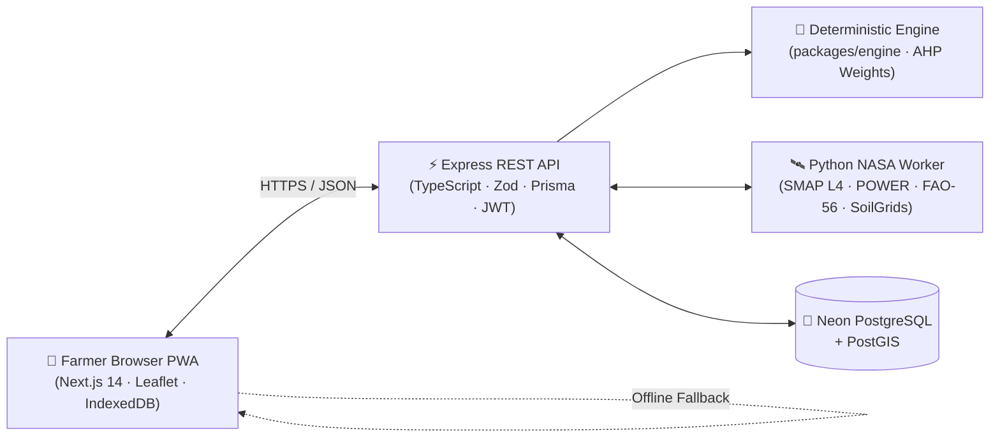

<div align="center">

# 🌱 TerraShift (টেরাশিফ্‌ট)
### Climate-Adaptive Multi-Year Crop Rotation Using NASA Earth Observations

[](https://agronova-five-theta.vercel.app)
[](https://www.spaceappschallenge.org/)
[]()
[](LICENSE)

**An offline-first, bilingual (বাংলা / English) agronomic decision-support PWA empowering smallholder delta & drought-zone farmers with NASA SMAP L4, Landsat 9 SSEBop ET, and NASA POWER telemetry.**

[🚀 Launch Live App](https://agronova-five-theta.vercel.app) · [📊 Dashboard](https://agronova-five-theta.vercel.app/dashboard) · [🛰️ NASA Data Pipeline](docs/nasa-data-integration.md) · [📐 Scoring Equations](docs/scoring.md)

<br />



</div>

---

## 🎯 For NASA Space Apps Judges: 60-Second Walkthrough

1. **Open the Live Deployment**: Visit **[agronova-five-theta.vercel.app/dashboard](https://agronova-five-theta.vercel.app/dashboard)**.
2. **One-Click Demo Farmer Login**: Click **লগইন (Login) → "কৃষক রফিক হিসেবে প্রবেশ (১-ক্লিক ডেমো)"** to load an authenticated smallholder profile backed by **Neon PostgreSQL / PostGIS**.
3. **Compare Two Real Bangladesh Agro-Ecological Benchmarks**:
   - **Barind Tract Drought Zone (Porsha, Naogaon · `24.9030° N, 88.4830° E` · AEZ-25)**: Severe groundwater drawdown & high heat stress (`ET₀ = 3.82 mm/day`, SMAP rootzone `0.194 m³/m³`).
   - **Coastal Delta Zone (Babuganj, Barisal · `22.7010° N, 90.3535° E` · AEZ-13)**: Saline & tidal submergence risk (`SMAP rootzone = 0.26 m³/m³`).
4. **Interactive Field Recalculation**: Drop a pin anywhere on the map or edit farm size, soil type, and priority weights — watch the 3-year / 4-year crop rotations, water savings, BNF nitrogen gain, and BDT income scale dynamically.
5. **1-Page Printable Farmer Advisory PDF**: Click **"অফিসিয়াল সনদ / PDF"** to generate a clean, single-page A4 landscape agronomic advisory certificate for local extension officers (DAE).
6. **True Airplane-Mode Test**: Toggle **"অফলাইন মোড"** in the header to verify zero-internet execution via IndexedDB and pre-bundled AEZ baselines.

---

## 📖 Executive Summary & The Problem

Across Bangladesh's Barind drought belt and the lower Ganges–Brahmaputra–Meghna delta, millions of smallholder farmers are trapped in continuous double-rice monoculture (*Boro Rice → Fallow → T. Aman Rice*). This depletes topsoil organic carbon below `1.0%`, accelerates aquifer collapse from diesel groundwater pumping, and locks pest lifecycles across consecutive seasons.

> *"Human-induced soil degradation affects 34% of agricultural land, and if current unsustainable agricultural practices continue, up to 90% of the Earth's topsoil could be at risk of degradation by 2050."* — **FAO (2022), SOLAW 2021** ([DOI: 10.4060/cb9910en](https://doi.org/10.4060/cb9910en), Ch. 2, Sec. 2.3)

**TerraShift (টেরাশিফ্‌ট)** translates complex NASA satellite granules into actionable **3-Year (9-Season) and 4-Year (12-Season) crop rotation schedules** tailored to smallholder plots—without needing expensive lab soil tests or continuous 4G internet.

---

## 🚀 Why TerraShift Stands Out

| Dimension | Static Extension Pamphlets | Black-Box AI Chatbots | Commercial AgTech | **TerraShift (Team AgroNova)** |
| :--- | :--- | :--- | :--- | :--- |
| **Satellite Assimilation** | None (static annual calendar) | Hallucination-prone, no telemetry | Paid US/EU-centric subscriptions | **Live NASA POWER + SMAP L4 + Landsat 9 SSEBop** |
| **Explainability** | Rigid rulebooks | Unverifiable LLM guesses | Closed proprietary scoring | **100% deterministic formulas with peer-reviewed citations** |
| **Regional Fit** | Generic national advice | Untrained on 3-season delta | Built for mechanized monocrops | **Tuned for Rabi / Kharif-1 / Kharif-2 & BARI/BRRI varieties** |
| **Offline Resilience** | Paper only | Requires constant 4G | Cloud-dependent | **True offline PWA: IndexedDB + browser-side CPU engine** |
| **Farmer Agency** | Prescriptive, one-size-fits-all | No multi-objective trade-offs | Enterprise-focused | **Interactive Water / Soil / Nitrogen sliders + decision-support banner** |

---

## 🛰️ Strict Scientific Transparency: NASA vs. External Datasets

TerraShift explicitly separates NASA Earth Observation products from external non-NASA datasets across the UI, telemetry modals, and documentation:

### Section A: Direct NASA Earth Observations
- **NASA SMAP L4 (`SPL4SMGP` · 9 km)**: Surface (`0–5 cm`) and rootzone (`0–100 cm`) volumetric soil moisture retrieved via spherical geodesic nearest-cell lookup.
- **NASA POWER Agroclimatology (`0.5° × 0.5°`)**: Daily temperature (`T2M`, `T2M_MAX`, `T2M_MIN`), corrected precipitation (`PRECTOTCORR`), solar irradiance (`ALLSKY_SFC_SW_DWN`), dewpoint (`T2MDEW`), and wind speed (`WS2M`), tracking heat-stress days ($\ge 33^\circ\text{C}$).
- **Landsat 8/9 Thermal ET (SSEBop) & MODIS Cross-Check**: Thermal surface energy balance evaporative fraction ($ET_a = ET_f \times k \times ET_0$) validated against MODIS (`±15%` consistency band) alongside **FAO-56 Penman-Monteith** reference evapotranspiration ($ET_0$).
- **NASA SRTM**: Digital elevation context for flood-plain vs. upland barind runoff classification.

### Section B: Non-NASA External Reference Data (Explicitly Demarcated)
- **ISRIC SoilGrids REST (Wageningen, Netherlands)**: 250 m soil texture and pH baseline (*explicitly labeled as non-NASA in all UI views*).
- **BARI / BRRI / BJRI / BWMRI**: Official Bangladesh varietal maturity days, salinity/drought tolerance, and biological nitrogen fixation tables.
- **OpenStreetMap & Esri World Imagery**: Interactive field selection tiles via Leaflet.

---

## 🔬 Quantitative Models & Agronomic Impact

1. **Biological Nitrogen Fixation (BNF) Mass Balance** (*Peoples et al., 2001, 2009; BARI Pulses Trials*):
   $$\Delta N_{\text{bio}} = \left( \text{BNF}_{\text{crop}} \times f_{\theta}(\text{SMAP}) \times f_{\text{pH}} \right) - N_{\text{harvest\_removal}}$$
   Incorporating Mungbean (*BARI Mung-6*) or Lentil (*BARI Masur-8*) fixes **35–75 kg N/ha/year**, cutting synthetic urea needs by **35%–45%**.
2. **Soil Organic Carbon (SOC) Trajectory** (*RothC / IPCC Tier 1 AFOLU; Hossain et al., 2021*):
   $$\Delta \text{SOM}_{\text{annual}} = \sum \left[ C_{\text{biomass}} \times k_{\text{humification}} \right] - \text{SOM}_{\text{oxidation}}$$
   Pulse stover and jute leaf litter return rebuild topsoil organic matter by **+0.12% to +0.18%/year** instead of depleting under bare fallow.
3. **Botanical Family Alternation**: Enforces *Poaceae → Fabaceae → Brassicaceae* rotation to break Brown Planthopper and Sheath Blight host cycles (**-67% pest vulnerability**).

| Indicator | Conventional (Boro–Fallow–Aman) | TerraShift Adaptive Rotation | Net Benefit (per Hectare / Year) |
| :--- | :--- | :--- | :--- |
| **Irrigation Demand** | `1,300 mm/yr` (`13,000 m³`) | `450–550 mm/yr` (`5,000 m³`) | **-61.5% pumping cut** (`~4,600–8,000 m³` saved) |
| **Diesel Pumping Cost** | `৳18,000 – 24,000` | `৳6,000 – 8,000` | **Saves ৳12,000 – 16,000/ha/yr** |
| **Biological Nitrogen** | `0 kg N/ha` | `+45 to +75 kg N/ha` | **Replaces 75–125 kg urea** (`৳2,500–4,500` saved) |
| **Soil Organic Matter** | `-0.04% / yr` (depleting) | `+0.12% to +0.18% / yr` | **Reverses delta topsoil degradation** |
| **Pest Vulnerability** | `8.5 / 10` (High) | `2.8 / 10` (Low) | **-67% monoculture pest pressure** |

---

## 🏗️ System Architecture



```text
AgroNova/
├── apps/
│   ├── web/            # Next.js 14 PWA (Vercel) — Bilingual UI, Leaflet, IndexedDB, Print Certificate
│   ├── api/            # Express + TypeScript REST API (Render) — Auth, Farms, Recommendations
│   └── worker/         # Python 3.11 NASA Ingest Worker (Render) — SMAP L4, POWER, FAO-56, SoilGrids
├── packages/
│   └── engine/         # Shared Deterministic Crop Rotation Scoring Engine (Vitest tested)
├── prisma/             # PostgreSQL + PostGIS Schema & Migrations
└── docs/               # Formulas, Validation Plan, NASA Integration, Presentation Guide
```

---

## ☁️ Production Deployment Stack (Zero-Docker Cloud Architecture)

TerraShift runs in production without Docker on modern serverless and managed PaaS infrastructure (and also ships with a full `docker-compose.yml` for self-hosted container deployments):

| Layer | Platform | Root / Config | Key Environment Variables |
| :--- | :--- | :--- | :--- |
| **Frontend PWA** | **Vercel** | `apps/web` | `NEXT_PUBLIC_API_URL=https://<api>.onrender.com/api/v1` |
| **Backend API** | **Render (Node)** | Monorepo Root | `DATABASE_URL`, `JWT_SECRET`, `NASA_INGEST_WORKER_URL` |
| **NASA Worker** | **Render (Python 3)** | `apps/worker` | `POWER_TTL_HOURS=24`, `SMAP_TTL_DAYS=7`, `EARTHDATA_*` *(optional)* |
| **Spatial Database** | **Neon DB** | PostgreSQL + PostGIS | `npx prisma migrate deploy --schema=prisma/schema.prisma` |

---

## 💻 Local Development & Testing

### 1. Multi-Terminal Local Run
```bash
# Clone & install workspace dependencies
git clone https://github.com/ZisanUlHaque/AgroNova.git
cd AgroNova
cp .env.example .env
npm install
npm run build:engine
npx prisma generate --schema=prisma/schema.prisma

# Terminal 1 — Python NASA Worker (Port 8010)
pip install -r apps/worker/requirements.txt
python apps/worker/worker.py --serve

# Terminal 2 — Express REST API (Port 5000)
npm run dev:api

# Terminal 3 — Next.js PWA (Port 3000)
npm run dev:web
```

### 2. Docker Compose (Optional All-in-One Container Stack)
```bash
cp .env.example .env
docker compose up -d --build
docker compose exec api npx prisma migrate deploy
```

### 3. Automated Verification Suites
```bash
npm run test:engine        # Rotation constraints, legume alternation & AHP scoring (Vitest)
npm run test:api           # Auth, farm ownership isolation & validation (Vitest)
npm run test:worker        # FAO-56 ET0 math, SMAP nearest-cell & -999 handling (Pytest)
```

---

## 🛰️ NASA Datasets Used & Exact Codebase Files

Every NASA Earth Observation product used in TerraShift is transparently traceable from satellite ingestion through scoring and UI presentation:

| NASA Dataset / Product | Resolution & Parameters Extracted | Where Ingested, Processed & Rendered (Exact Files) |
| :--- | :--- | :--- |
| **NASA SMAP L4 (`SPL4SMGP`)** | `9 km` · Surface (`0–5 cm` `sm_surface`) & Rootzone (`0–100 cm` `sm_rootzone`) volumetric soil moisture via spherical nearest-cell search (`h5py` HDF5 granules) | **Ingest & HDF5 Extraction**: [`apps/worker/smap.py`](apps/worker/smap.py), [`apps/worker/worker.py`](apps/worker/worker.py), [`apps/worker/pipeline_barind.py`](apps/worker/pipeline_barind.py)<br/>**API Caching & Scoring**: [`apps/api/src/services/nasaService.ts`](apps/api/src/services/nasaService.ts), [`apps/api/src/services/recommendationService.ts`](apps/api/src/services/recommendationService.ts), [`packages/engine/src/scoring.ts`](packages/engine/src/scoring.ts)<br/>**UI & Offline Telemetry**: [`apps/web/src/components/NasaContextModal.tsx`](apps/web/src/components/NasaContextModal.tsx), [`apps/web/src/components/PlanView.tsx`](apps/web/src/components/PlanView.tsx), [`apps/web/src/components/MapPicker.tsx`](apps/web/src/components/MapPicker.tsx) |
| **NASA POWER Agroclimatology (`AG` Community API)** | `0.5° × 0.5°` · Daily `T2M`, `T2M_MAX`, `T2M_MIN`, `T2MDEW`, `PRECTOTCORR`, `ALLSKY_SFC_SW_DWN`, `WS2M` + **FAO-56 Penman-Monteith $ET_0$** & heat-stress days ($\ge 33^\circ\text{C}$) | **Live API Fetch & ET₀ Math**: [`apps/worker/power.py`](apps/worker/power.py), [`apps/worker/et0.py`](apps/worker/et0.py), [`apps/api/src/services/nasaService.ts`](apps/api/src/services/nasaService.ts)<br/>**Scoring & Trend Charts**: [`packages/engine/src/scoring.ts`](packages/engine/src/scoring.ts), [`apps/web/src/components/PowerTrendChart.tsx`](apps/web/src/components/PowerTrendChart.tsx), [`apps/web/src/components/Dashboard.tsx`](apps/web/src/components/Dashboard.tsx)<br/>**Precomputed Benchmark**: [`apps/web/public/data/barind_naogaon_telemetry.json`](apps/web/public/data/barind_naogaon_telemetry.json) |
| **Landsat 8/9 Collection 2 Level-2 (Thermal ET · SSEBop)** | `30 m` · Land Surface Temperature (LST) + NDVI converted via Simplified Surface Energy Balance ($ET_a = ET_f \times k \times ET_0$) | **SSEBop Computation**: [`apps/worker/pipeline_barind.py`](apps/worker/pipeline_barind.py)<br/>**Telemetry & Advisory Output**: [`apps/web/public/data/barind_naogaon_telemetry.json`](apps/web/public/data/barind_naogaon_telemetry.json), [`apps/web/src/components/PlanView.tsx`](apps/web/src/components/PlanView.tsx), [`apps/web/src/components/NasaContextModal.tsx`](apps/web/src/components/NasaContextModal.tsx), [`apps/web/src/components/FarmerReportModal.tsx`](apps/web/src/components/FarmerReportModal.tsx) |
| **MODIS (`MOD16A2GF` 8-Day ET)** | `500 m` · Evapotranspiration cross-check calibration against Landsat 9 (`±15%` validation delta) | **Cross-Check Benchmark & Display**: [`apps/worker/pipeline_barind.py`](apps/worker/pipeline_barind.py), [`apps/web/src/components/PlanView.tsx`](apps/web/src/components/PlanView.tsx), [`apps/web/src/components/NasaContextModal.tsx`](apps/web/src/components/NasaContextModal.tsx) |
| **NASA SRTM Digital Elevation** | `30 m` · Plot elevation context (`28 m` Barind vs. coastal floodplain) for runoff & submergence risk | **Telemetry & Map Pin Context**: [`apps/worker/pipeline_barind.py`](apps/worker/pipeline_barind.py), [`apps/web/src/components/MapPicker.tsx`](apps/web/src/components/MapPicker.tsx) |
| **Non-NASA External Data *(Strictly Demarcated)*** | **ISRIC SoilGrids REST** (`250 m` soil texture & pH) + **BARI / BRRI / BJRI / BWMRI** varietal tables | **External Fetching & Isolation**: [`apps/worker/soilgrids.py`](apps/worker/soilgrids.py), [`packages/engine/crops.json`](packages/engine/crops.json), [`apps/web/src/lib/planGenerator.ts`](apps/web/src/lib/planGenerator.ts) |

---

## 📜 Citations & AI Disclosure

- **FAO SOLAW (2021/2022)**: *The State of the World's Land and Water Resources for Food and Agriculture: Systems at breaking point*. DOI: [10.4060/cb9910en](https://doi.org/10.4060/cb9910en), Ch. 2, Sec. 2.3.
- **NASA Earthdata**: SMAP L4 Global 3-hourly 9 km Surface and Rootzone Soil Moisture (`SPL4SMGP`), NASA POWER Daily Agroclimatology API, Landsat 8/9 SSEBop ET.
- **AI Disclosure**: AI coding assistants were used to accelerate TypeScript scaffolding, UI polish, and Bengali/English localization. All agronomic formulas, crop duration constraints, satellite data provenance, and BARI/BRRI research figures were independently verified by Team AgroNova.

---

<div align="center">
  <strong>Built with ❤️ by Team AgroNova · NASA Space Apps Challenge 2026</strong>
</div>
